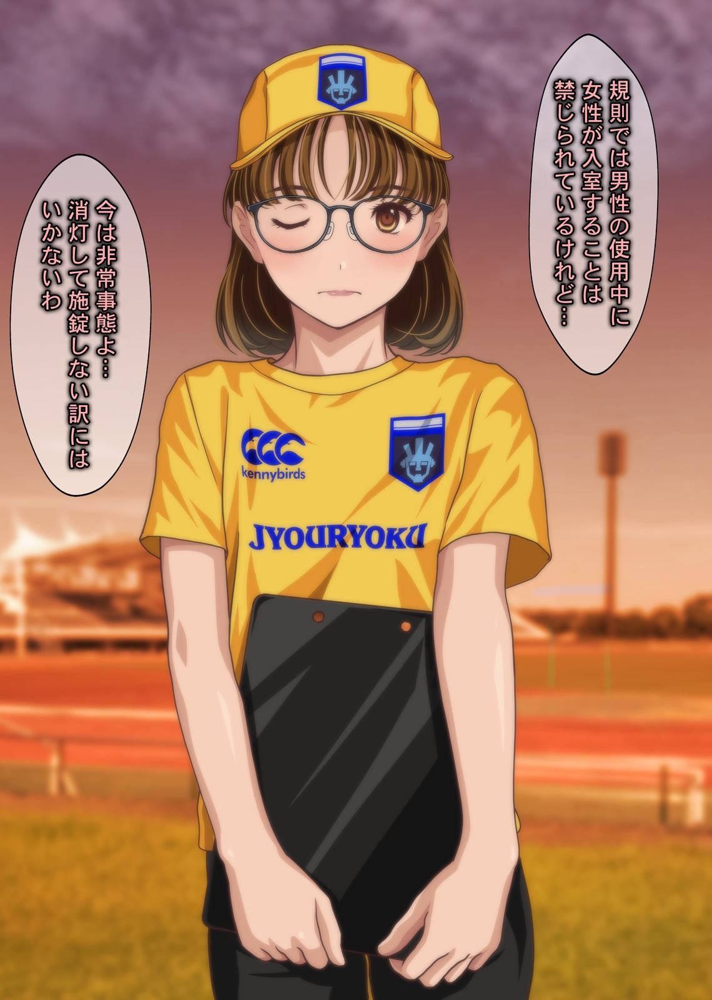
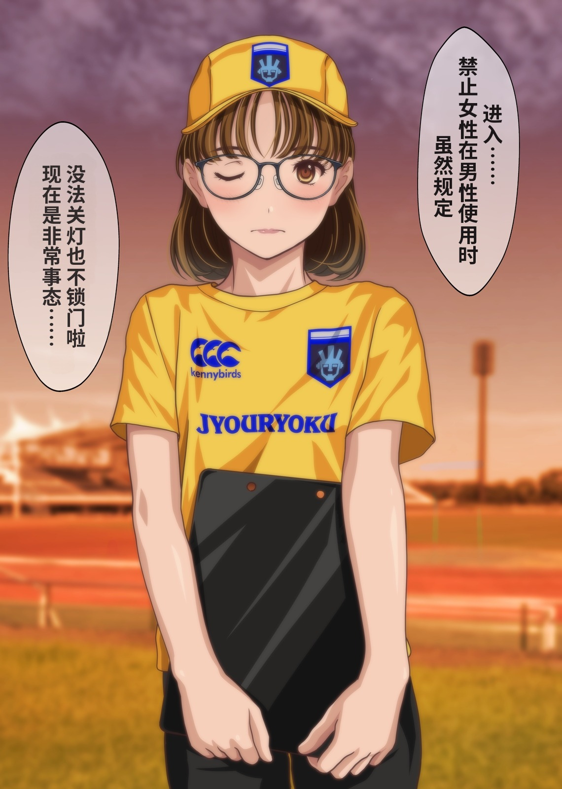
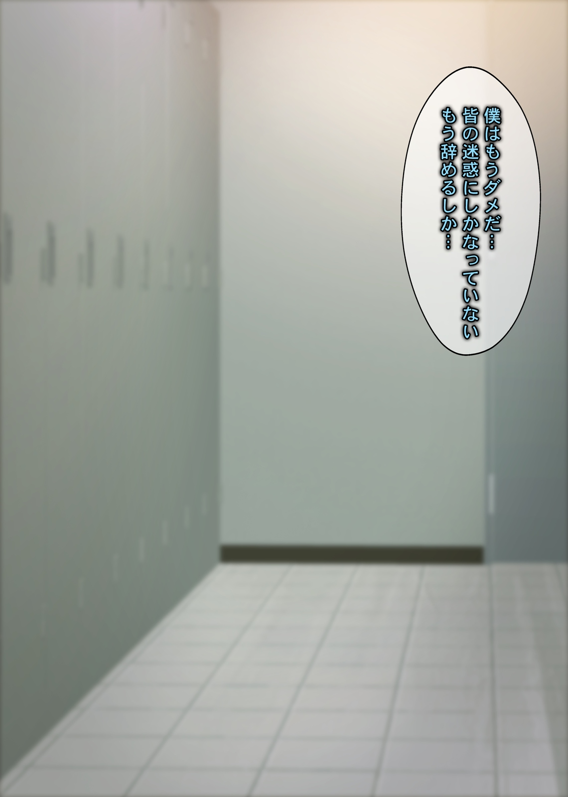
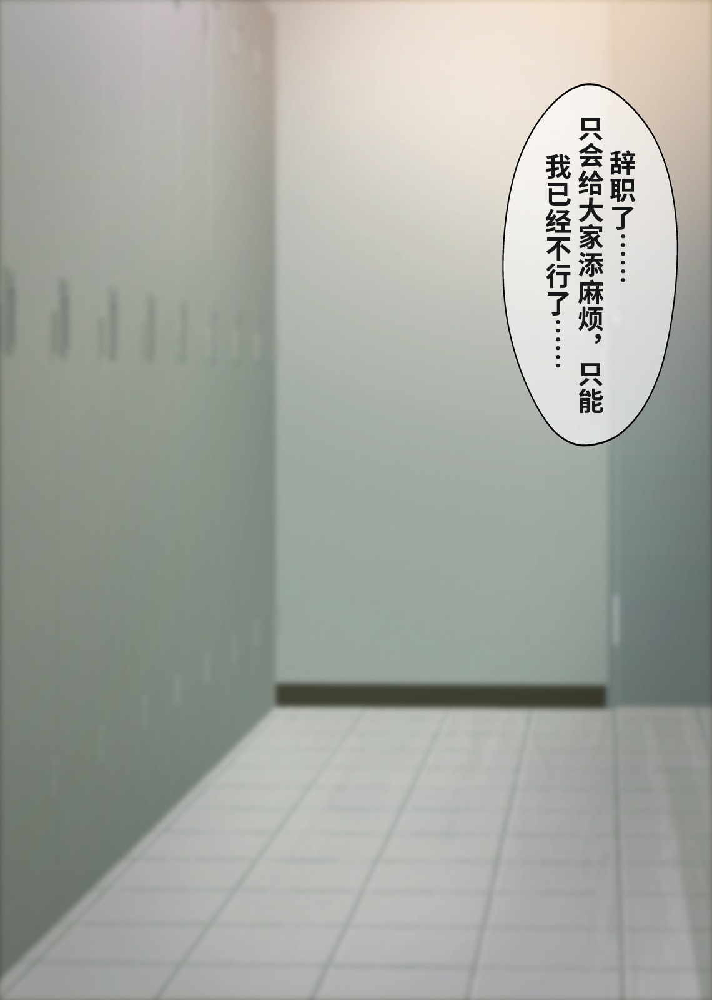

# 汉 · 一键汉化漫画

**4.0.5 · Windows 桌面工具 · MIT 开源**

把漫画中的日文、韩文或英文对白转换成简体 / 繁体中文：检测气泡和文字 → OCR → 翻译 → 去字修复 → 气泡排版 → 导出。支持本地翻译大模型，也支持填写 API Key 调用云端模型。

> **硬件性能不足时，强烈推荐使用 API 翻译。** 没有独显、显存较小、内存紧张，或者本地模型速度慢时，在「设置 → 翻译」关闭本地大模型、开启「API 服务（填 Key）」即可。无需下载和运行本地翻译大模型；文字识别、背景修复和排版仍在你的电脑上完成，可选择 CPU 或显卡加速。
>
> 👉 [API Key 申请和填写教程：DeepSeek / 硅基流动 / Gemini / OpenAI / OpenRouter](docs/API_SETUP.md)

## 功能

- **检测与识别**：气泡内文字、气泡外旁白、竖排 / 横排、长条页面；支持日 / 韩 / 英原文。
- **翻译选择**：llama.cpp 本地 GGUF 模型；DeepSeek、硅基流动、OpenAI、Gemini、OpenRouter 和自定义 OpenAI 兼容 API；免费在线翻译兜底。
- **背景修复**：纯色气泡填色，复杂背景使用 LaMa；限制修改区域，尽量保留原画。
- **中文排版**：按气泡内部空间适配字号；支持横排、竖排、左到右 / 右到左列序、字体和描边。
- **队列与断点**：逐页保存进度，暂停 / 继续，失败重试；重复导入可建立独立任务。
- **校对编辑**：修改原文 / 译文、保留原文、重新排版与导出、术语表和前后对比。
- **输入**：文件夹、散图、ZIP/CBZ、7z/CB7、RAR/CBR、TAR/CBT、PDF、EPUB、嵌套压缩包。
- **输出**：图片文件夹、ZIP/CBZ、PDF、EPUB；图片使用 JPG / PNG / WebP。

7z / RAR 等格式需要系统 `tar.exe`（bsdtar）或已安装的 7-Zip。压缩包损坏、加密、特殊编码和部分电子书版式可能无法处理。

## 从源码运行

建议使用 **Windows 10/11、64 位 Python 3.12 和 Microsoft Edge WebView2**。三个 ONNX 后端应分别装在独立环境里，不能在同一环境混装 `onnxruntime`、`onnxruntime-directml`、`onnxruntime-gpu`。

### 1. 获取源码并安装依赖

```powershell
git clone https://github.com/NingLoke/hanhua-manga.git
cd hanhua-manga
py -3.12 -m venv .venv
.\.venv\Scripts\python.exe -m pip install -e ".[cpu,dev]"
```

这是兼容性较好的 CPU 环境；使用 API 翻译也需要安装识别和修复依赖。有显卡时，可在一个新的环境中把 `cpu` 替换为 `dml`（通用显卡）或 `cuda`（NVIDIA）。是否能使用加速取决于显卡、驱动和对应运行库；初始化失败会回退到 CPU。

### 2. 下载模型和字体

```powershell
.\.venv\Scripts\python.exe -X utf8 build/fetch_assets.py --only models
.\.venv\Scripts\python.exe -X utf8 build/fetch_assets.py --only fonts
```

这些是检测 / OCR / 去字模型和开源字体，与翻译大模型不同。只使用 API 翻译时，到这里就够了。

要使用本地大模型翻译，再下载适合的 llama.cpp 后端，例如 CPU：

```powershell
.\.venv\Scripts\python.exe -X utf8 build/fetch_assets.py --only runtimes/llama/cpu
```

也可以选择 `runtimes/llama/vulkan` 或 `runtimes/llama/cuda`。在软件设置里再下载 / 导入翻译用的 `.gguf` 模型；模型可能占用数 GB 空间，按本机资源选择。下载源和文件清单见 [fetch_assets.py](build/fetch_assets.py)。

### 3. 启动

```powershell
.\.venv\Scripts\python.exe -X utf8 -m hanhua.app
```

拖入漫画，确认原文语言、目标语言、阅读方向及翻译方式后开始。建议先试几页并校对，再处理整本。

只想看界面，可以运行 `python -m hanhua.app --demo`；这是演示引擎，**不会进行真实模型翻译**。无桌面窗口的界面调试可使用 `--demo --no-window`。

## API 翻译：低配电脑强烈推荐

API 把翻译大模型运行在服务商的服务器上，减少本机显存 / 内存压力；本机仍须运行 OCR、背景修复和排版。云端调用需要网络，是否付费、可用模型和配额以服务商当前控制台为准。

1. 从服务商官网创建 API Key，见[逐步教程与官网链接](docs/API_SETUP.md)。
2. 在「设置 → 翻译」**关闭本地大模型**，开启「API 服务（填 Key）」。
3. 选择服务商，填写 Key，点击「获取模型列表」，选择可用的文本对话模型。
4. 保存并用「测试连接」及少量页面检查。测试连接会发起真实请求，可能产生费用。

推荐先用 DeepSeek 或硅基流动按教程配置；也可选 Gemini、OpenAI、OpenRouter。模型必须兼容 Chat Completions 和本软件所需的 JSON 输出；获取到模型列表不代表所有模型都兼容。

## 开发与打包

```powershell
# 原创合成图与离线回归；先下载字体
.\.venv\Scripts\python.exe -X utf8 -m pytest tests -m "not network" -q

# 界面任务事件回归（需要 Node.js）
node --test tests/test_job_events.cjs

# 准备某个打包环境（cpu / dml / cuda / all）
powershell -ExecutionPolicy Bypass -File build/setup_envs.ps1 -Variant cpu -Python python
.\envs\cpu\Scripts\python.exe -X utf8 build/build.py --variant cpu
```

`-Python` 请指向 Python 3.12 或更新版本。打包前下载对应资源与 llama.cpp 后端；打包参数为 `cpu`、`gpu`（DirectML）、`nvidia`（CUDA）或 `all`。结果在 `build/dist/` 和 `build/release/`。打包脚本默认执行离线模型自检。

主要源码在 `hanhua/`，测试在 `tests/`，下载和打包工具在 `build/`。旧接口设计记录见 [ARCHITECTURE.md](docs/ARCHITECTURE.md)，实际行为以 4.0.5 源码和测试为准。

## 数据、限制和许可证

设置、翻译缓存、断点和日志默认保存在 `%APPDATA%\HanhuaManga`；`HANHUA_DATA` 可指定独立数据目录。API Key 及任务快照目前保存在本机文件中，请勿公开这些文件。使用云端翻译时，识别出的台词、相关上下文和术语表会发给所选服务商；Key 用于向该服务商认证。

自动 OCR、翻译、去字和排版可能出错，尤其是花体字、开放气泡、拟声词和复杂背景；请使用校对功能检查。示例不表示所有漫画都能达到同样效果。

项目自有源码使用 [MIT License](LICENSE)，允许修改、分发与商业使用，需保留许可证。第三方代码、模型、运行库和字体适用其各自许可，见 [THIRD_PARTY_NOTICES.md](THIRD_PARTY_NOTICES.md)。漫画示例图片不适用源码 MIT 许可证。请只处理、发布你有权使用的内容。

## 汉化前后对比

以下来自作者本机已有的真实汉化导出，并非演示模式或重新手工绘制；**左边为原图，右边为已有汉化结果**。图片文件保留原始内容，仅在网页中缩放显示，没有另行修饰气泡、背景或译文。历史导出没有记录翻译模型及参数，因此不将其标成某个 API 或某个模型的性能承诺。

### 示例 1：彩色页面与双气泡

**原图（日文）　/　汉化后（中文）**

<p>
  
  
</p>

### 示例 2：场景背景与竖排对白

**原图（日文）　/　汉化后（中文）**

<p>
  
  
</p>

示例漫画版权归原作者，图片仅用于本项目处理效果展示，不随源码 MIT 许可重新授权。详情与原始文件校验值见 [示例来源说明](docs/examples/README.md)。
